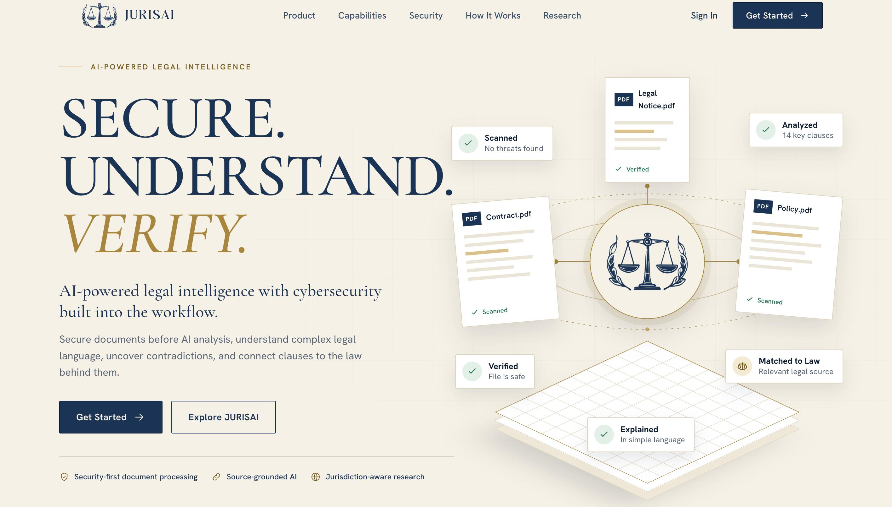
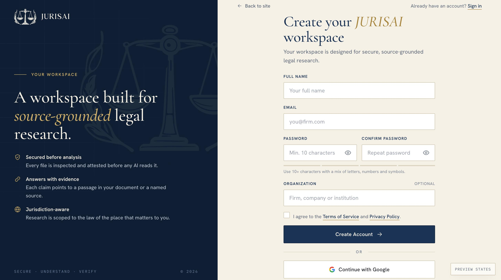
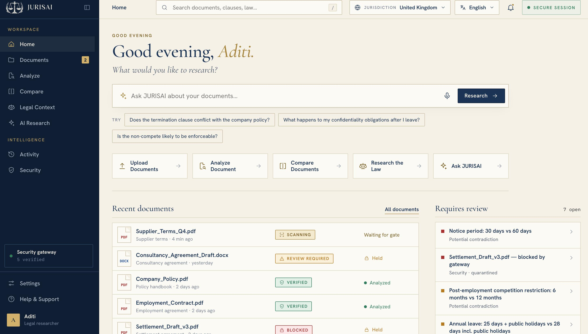
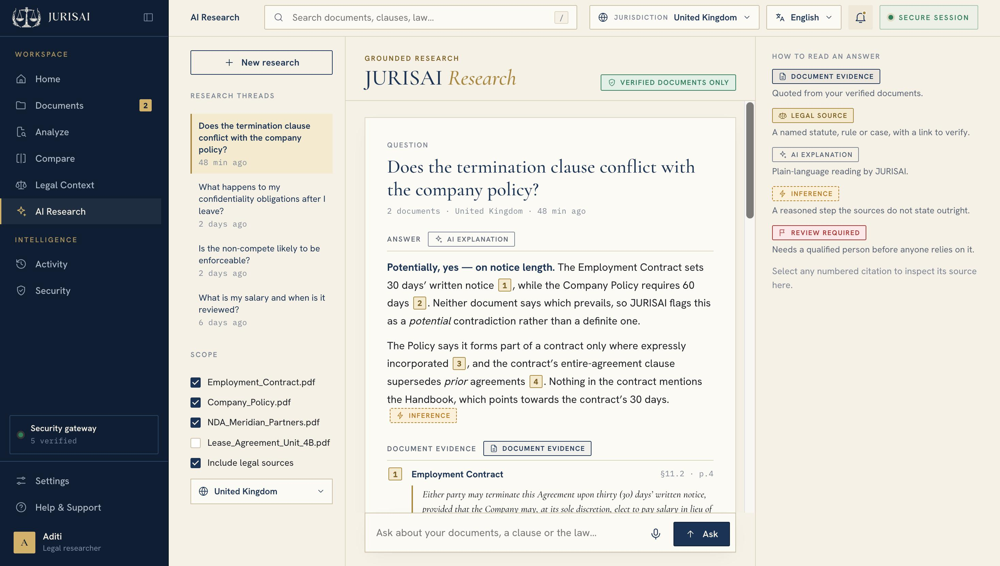
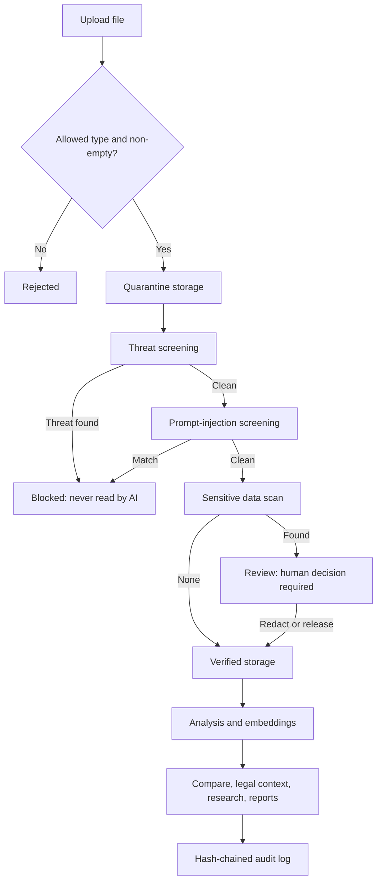

<div align="center">


</div>

<div align="center">

**Understand your legal documents. Trust the evidence behind every answer.**

*A secure, local-first legal intelligence platform powered by Python, FastAPI, and on-device AI*

[](https://fastapi.tiangolo.com/)
[](https://www.python.org/)
[](https://www.sqlite.org/)
[](https://ollama.com/)
[](https://www.docker.com/)

</div>

---

## Overview

**JURISAI** is a security-first legal document intelligence platform for legal researchers, analysts, and professionals who need to understand, compare, and audit complex legal documents without sending sensitive content to external cloud services.

Every uploaded document passes through a multi-stage security gate before any AI component reads it. Documents with embedded threats or prompt-injection attempts are quarantined, documents containing sensitive identifiers are held for human review, and only verified documents reach the analysis pipeline.

AI runs on-device through [Ollama](https://ollama.com/), with a built-in deterministic fallback when Ollama is not running. No cloud API keys are required for core features.

> **Status:** JURISAI is a prototype built for research and demonstration. It is not production-hardened, has not been security audited, and does not provide legal advice.

---

## The Problem

- **Complexity:** a single contract can contain dozens of interdependent clauses.
- **Cross-document conflicts:** notice periods, confidentiality terms, and covenants often contradict each other across related documents.
- **Accessibility:** legal language is opaque to non-lawyers.
- **Security risk:** feeding unscreened documents into AI systems exposes users to prompt injection and data leakage.
- **Accountability:** most AI tools give answers without traceable evidence.

## Our Solution

JURISAI uses a **security-gate-first, evidence-grounded pipeline**:

1. Every upload is quarantined and scanned before any AI reads it.
2. Verified documents are analysed for clauses, obligations, dates, and issues.
3. Clauses from different documents are compared to surface contradictions.
4. Clauses are linked to statutes and case law for the selected jurisdiction.
5. Research answers cite the specific clauses they come from.
6. Every action is recorded in a SHA-256 hash-chained audit log.

---

## User Interface

JURISAI is a server-rendered vanilla JavaScript single-page app served by the FastAPI backend. No frontend build step is needed.

<div align="center">

#### Landing Page


*Security-first, source-grounded legal intelligence.*

---

#### Create Your Workspace


*Account registration with password strength guidance.*

---

#### Home Dashboard


*Recent documents with their security-gate status (scanning, review required, verified, blocked) and open items requiring review.*

---

#### Grounded AI Research


*Answers with numbered citations to document evidence, labelled as document evidence, legal source, AI explanation, inference, or review required.*

</div>

| View | Description |
|------|-------------|
| Landing, Sign In, Sign Up | Account access and email verification |
| Document Library | Upload, list, archive, restore, delete |
| Security Gateway | Per-document scan results and review decisions |
| Document Analysis | Clauses, summary, obligations, issues |
| Compare & Contradict | Multi-document comparison and findings |
| Legal Context | Clause-to-statute and case-law mapping |
| AI Research | Question answering with clause citations |
| Reports | Generate, share, and download reports |
| Activity Log | Hash-chained audit timeline |
| Settings and Help | Sessions, password, help articles |

---

## Key Features

### Multi-Stage Security Gateway

Each upload is inspected in order before any AI component sees it:

1. **Integrity check** – rejects empty or unreadable files.
2. **Threat screening** – flags PDFs with embedded scripts or launch actions and Word files with macros.
3. **Prompt-injection screening** – pattern-based detection of instruction-override phrases in extracted text.
4. **Sensitive data inspection** – detects identifiers such as Aadhaar, PAN, SSN, and card numbers, and masks them before storage.

Outcomes: **blocked** (quarantined, never read by AI), **review** (held for a human decision to redact, release, hold, or escalate), or **verified** (moved to verified storage and analysed).

> Pattern-based detection reduces risk but is not a guarantee against prompt injection.

### Document Parsing

Supports **PDF, DOCX/DOC, and TXT** (up to 50 MB by default). Clause structure is extracted from numbered provisions and sections. Scanned, image-only PDFs are not supported.

### Analysis

Rule-based extraction of clauses, dates, obligations, definitions, governing-law references, and flagged issues such as restrictive covenants. An LLM (Ollama) is used where available, with a deterministic fallback otherwise.

### Cross-Document Contradiction Detection

Compares clauses across documents (for example notice periods and confidentiality terms) and records severity, quoted evidence from both sides, and an explanation. Detection is keyword-based, so findings are indicators to review, not conclusions.

### Legal Context

Maps clauses to statutes and case law, with authority levels, for **UK, India, and US** jurisdictions.

### Grounded Research (RAG)

Answers questions about your uploaded documents with clause-level citations and a grounding level. Retrieval uses similarity search over locally computed clause embeddings.

### Reports, Review Workflow, and Audit Log

- Generate reports with shareable links and plain-text download.
- Review workflow for contradiction findings with actor-attributed events.
- Tamper-evident audit log, where each event hashes the previous one and the full chain can be verified.

### Translation and Voice

Hindi and Spanish translation (legal glossary plus local LLM), and browser-native text-to-speech and voice input.

### Authentication

Argon2 password hashing, hashed session tokens in HttpOnly cookies, CSRF protection, and session management.

---

## Architecture

| Layer | Technology |
|-------|-----------|
| Backend | FastAPI, Uvicorn, Python 3.12 |
| Data | SQLAlchemy, SQLite (default), PostgreSQL + pgvector (optional) |
| AI | Ollama (local), optional OpenAI, built-in heuristic fallback |
| Parsing | pypdf, pdfplumber, python-docx |
| Frontend | Vanilla JS, HTML, CSS |
| Optional services | Redis, Mailpit, MinIO via Docker Compose |



---

## Installation

### Prerequisites

- Python 3.12+
- Git
- Optional: [Ollama](https://ollama.com/) for live LLM output, Docker for the extra services

### Quick Start

```bash
git clone <your-repo-url>
cd <repo-directory>

python3.12 -m venv .venv
source .venv/bin/activate        # Windows: .venv\Scripts\activate

pip install -r requirements.txt

PYTHONPATH=. python -m uvicorn backend.app.main:app --host 127.0.0.1 --port 8000 --reload
```

Open `http://127.0.0.1:8000`. The database is created and seeded with sample data on first run.

### Optional: Local AI with Ollama

```bash
ollama pull llama3.2
ollama serve
```

JURISAI detects Ollama automatically.

### Optional: Docker Compose

```bash
cp .env.example .env
# Set SECRET_KEY to a long random value, e.g. from: openssl rand -hex 32
docker compose up -d
```

---

## Configuration

Copy `.env.example` to `.env`. Common settings:

| Variable | Purpose |
|----------|---------|
| `SECRET_KEY` | Signing key. **Set your own value** before any real deployment. |
| `DATABASE_URL` | SQLite by default; PostgreSQL supported |
| `LLM_PROVIDER` | `ollama`, `openai`, or `local` |
| `OLLAMA_BASE_URL`, `OLLAMA_MODEL` | Local LLM endpoint and model |
| `EMBEDDING_PROVIDER` | `local` or `ollama` |
| `STORAGE_PATH` | Upload storage directory |
| `SCAN_MAX_FILE_SIZE_MB` | Maximum upload size |

Never commit your `.env` file.

---

## Project Structure

```
jurisai/
├── backend/
│   ├── app/
│   │   ├── main.py        # App entry point
│   │   ├── api/           # Route handlers
│   │   ├── models/        # ORM models
│   │   ├── schemas/       # Pydantic schemas
│   │   └── services/      # Security scanner, parsing, analysis, LLM, audit, reports
│   └── tests/             # End-to-end tests
├── assets/                # Frontend JS and logos
├── index.html, app.html, signin.html, signup.html, reset-password.html
├── Dockerfile
├── docker-compose.yml
├── requirements.txt
└── .env.example
```

---

## API

All routes are under `/api` and use session-cookie authentication with CSRF protection on mutating requests. When the server is running, interactive documentation is available at `/docs`.

Main areas: `auth`, `documents`, `security`, `analysis`, `compare` / `contradictions`, `legal`, `research`, `reviews`, `reports`, `audit`, `translate`, `search`.

---

## Testing

```bash
PYTHONPATH=. pytest backend/tests/test_e2e_flows.py -v
```

The end-to-end suite covers authentication, the security gate (including blocked and verified uploads), analysis, comparison, legal context, research, reports, and audit-chain verification. Security-specific tests are limited to these flows; the project has not had an independent security audit.

---

## Known Limitations

- Without Ollama, analysis and research use a deterministic heuristic engine and hash-based embeddings, so output quality is reduced.
- Contradiction detection is keyword-based, not semantic.
- Scanned (image-only) PDFs are not supported.
- Malware screening uses byte patterns and heuristics, not a full antivirus engine.
- Multi-factor authentication, production email delivery, rate limiting, and background job processing are not yet fully implemented.
- TLS must be provided by a reverse proxy in front of the app.

---

## Roadmap

- **Near term:** enforce MFA, production email delivery, rate limiting, asynchronous processing.
- **Medium term:** semantic contradiction detection, more jurisdictions and document types, multi-document comparison.
- **Longer term:** role-based access enforcement, webhooks, CLI, API keys.

---

## Privacy and Responsible Use

- Documents are processed and stored on your own infrastructure.
- Sensitive identifiers are masked before storage.
- Document text is sent to an external service only if you configure an external provider such as OpenAI.

**Disclaimer:** JURISAI provides AI-assisted document analysis for informational purposes only. It is not a substitute for advice from a qualified legal professional. Findings should be reviewed by a professional before any reliance.

---

## Contributing

Contributions to JURISAI are welcome! If you'd like to improve the project, fix bugs, or introduce new features, please follow these steps:

Fork the repository.

Create a feature branch for your changes.

Make your changes and test them thoroughly.

Commit your changes with a clear commit message.

Open a pull request describing your changes.

Please ensure your contributions align with the project's goals and maintain its security and code quality standards.

## License

JURISAI is licensed under the MIT License.

You are free to use, modify, and distribute this software in accordance with the terms of the licence. See the LICENSE file for details.

Copyright © 2026 Rishika Popli.

## Acknowledgements

[FastAPI](https://fastapi.tiangolo.com/), [SQLAlchemy](https://www.sqlalchemy.org/), [pypdf](https://github.com/py-pdf/pypdf), [python-docx](https://python-docx.readthedocs.io/), [argon2-cffi](https://argon2-cffi.readthedocs.io/), [pyotp](https://github.com/pyauth/pyotp), [Ollama](https://ollama.com/), [pgvector](https://github.com/pgvector/pgvector), [Mailpit](https://github.com/axllent/mailpit), [MinIO](https://min.io/)

---

<div align="center">


**JURISAI** · Security-first · Local-first · Evidence-grounded

</div>
